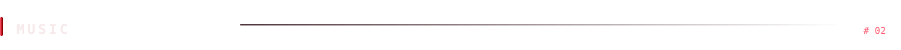

<picture>
  <source media="(max-width: 768px)" srcset="assets/header.svg" />
  
</picture>

 

 

<picture>
  <source media="(max-width: 768px)" srcset="assets/m/sections/about.svg" />
  
</picture>

- Fullstack Developer · Founder di **[mutiadev.site]**
- Membangun **[Home Lab]** — Linux, Docker, Nginx, dan layanan self-hosted
- Studi di **Institut Teknologi Sumatera**, berdomisili di **Metro, Indonesia**
- Suka bahas web dev, Linux, dan self-hosting — tanya apa saja di **[Issues]**

<picture>
  <source media="(max-width: 768px)" srcset="assets/m/sections/music.svg" />
  
</picture>

  <picture>
    <source media="(max-width: 768px)" srcset="assets/m/music.svg" />
    
  </picture>

<picture>
  <source media="(max-width: 768px)" srcset="assets/m/sections/stats.svg" />
  
</picture>

  
  

  <i>Build it, host it, document it — then make it a little faster.</i>

[mutiadev.site]: https://mutiadev.site "MutiaDev"
[Home Lab]: https://homelab.mutiadev.site "My Home Lab"
[Issues]: https://github.com/Mutiaacode/Mutiaacode/issues "GitHub Issues"
