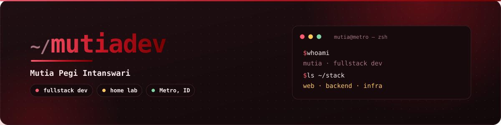
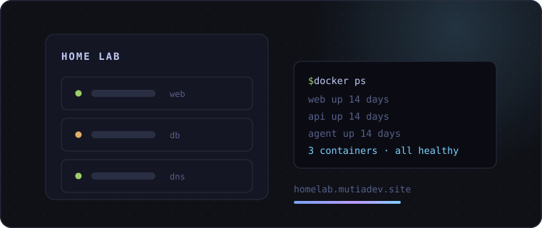
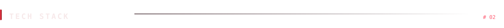
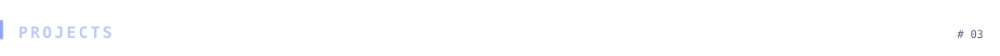
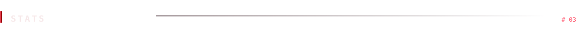
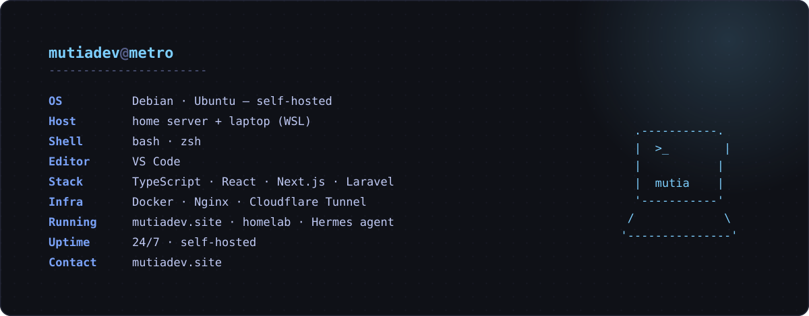

<picture>
  <source media="(max-width: 768px)" srcset="assets/m/header.svg" />
  
</picture>

 

<picture>
  <source media="(max-width: 768px)" srcset="assets/m/sections/about.svg" />
  
</picture>

- Founder & Fullstack Developer at **[mutiadev.site]**
- Building and documenting my **[Home Lab]** — Linux, Docker and self-hosted services
- Like to talk about **Web Development**, **Linux** and **Self-hosting**
- Studying at **Institut Teknologi Sumatera**
- Based in **Metro, Lampung, Indonesia**
- See my work on my **[Portfolio]**
- Ask me anything on my **[Issues Page]** or connect on **[LinkedIn]**

<picture>
  <source media="(max-width: 768px)" srcset="assets/m/sections/tech-stack.svg" />
  
</picture>

> Tools, languages and technologies I enjoy working with.

  

<table align="center">
  <tr>
    <td align="center" width="150"><b>Frontend</b></td>
    <td align="left">TypeScript &#183; React &#183; Next.js &#183; Vue &#183; Tailwind CSS</td>
  </tr>
  <tr>
    <td align="center"><b>Backend</b></td>
    <td align="left">Node.js &#183; Express &#183; Laravel &#183; PHP &#183; REST API</td>
  </tr>
  <tr>
    <td align="center"><b>Infra</b></td>
    <td align="left">Linux &#183; Docker &#183; Nginx &#183; Cloudflare Tunnel &#183; MySQL</td>
  </tr>
  <tr>
    <td align="center"><b>Daily</b></td>
    <td align="left">VS Code &#183; Git &#183; bash &#183; Ubuntu / Debian &#183; WSL</td>
  </tr>
</table>

<picture>
  <source media="(max-width: 768px)" srcset="assets/m/sections/projects.svg" />
  
</picture>

| Project | What it is | Stack |
| :--- | :--- | :--- |
| [mitdev-web](https://github.com/Mutiaacode/mitdev-web) | Landing page for a WhatsApp ads bot | Next.js |
| [ctxlint](https://github.com/Mutiaacode/ctxlint) | ESLint for the context your AI agent reads | Python |
| [mitdev-mcp](https://github.com/Mutiaacode/mitdev-mcp) | Diagnostic for MCP servers that refuse to show up | JavaScript |
| [Rentalin](https://github.com/Mutiaacode/Rentalin) | Car rental management web app | Laravel &#183; Blade |
| [alquran-online](https://github.com/Mutiaacode/alquran-online) | Read the Qur'an online, simple and responsive | TypeScript |
| [wokalms](https://github.com/Mutiaacode/wokalms) | Learning management platform for schools | Laravel &#183; Blade |

  

<picture>
  <source media="(max-width: 768px)" srcset="assets/m/sections/stats.svg" />
  
</picture>

  
  

  

<picture>
  <source media="(max-width: 768px)" srcset="assets/m/sections/connect.svg" />
  
</picture>

  
  
  
  

> *Build it, host it, document it, then make it a little faster.*

  

[mutiadev.site]: https://mutiadev.site "MutiaDev"
[Home Lab]: https://homelab.mutiadev.site "My Home Lab"
[Portfolio]: https://mutiadev.site "My Portfolio"
[LinkedIn]: https://www.linkedin.com/in/mutia-pegi-intanswari-184597298/ "Mutia Pegi Intanswari"
[Issues Page]: https://github.com/Mutiaacode/Mutiaacode/issues "GitHub Issues"

